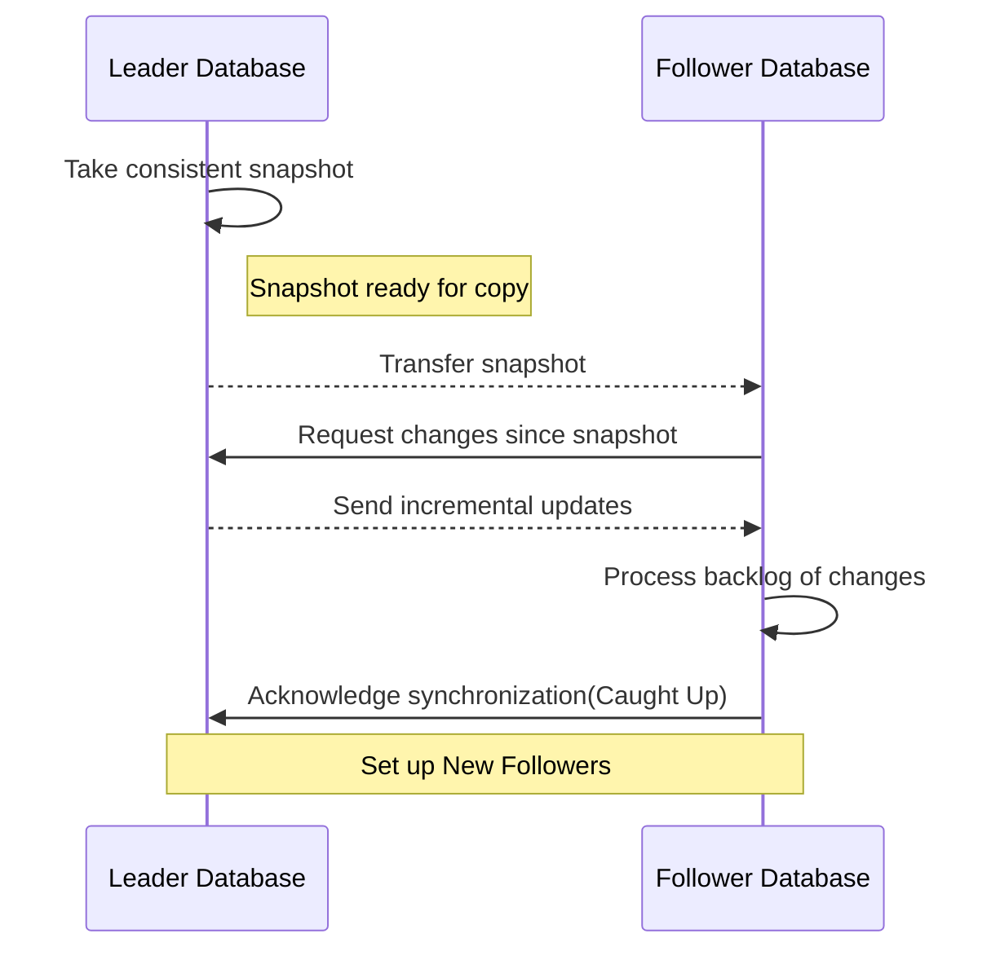

## What is Replication ?

Replication means keeping a copy of the same data on multiple machines that are
connected via a network.

In this chapter, we’ll assume that the data being replicated can fit into a single machine, no sharding is needed. 
 
If the data does not change over time, just replicate it, and then we're done. The difficulty lies in how do we handle the change to the replicated data?
## Leader-based(master-slave) Replication

Only Leader can accept write request, followers can only accept read request.

> Leader-based Replication is used by PostgreSQL, MySQL, MongoDB, RethinkDB, Kafka and RabbitMQ highly available queues.
## Synchronous & Asynchronous Replication

![[截圖 2024-12-07 下午2.42.03.png]]

It is not practical for all the followers to be synchronous, In practice, if you enable synchronous replication on a database, it usually means that one of the followers is synchronous, and the others are asynchronous(semi-synchronous).

In a asynchronously replicated system, if the leader fails, any writes that have not yet been replicated to followers are lost, and [chain replication](https://paper-notes.zhjwpku.com/distributedsystem/chain-replication.html) is a solution to prevent data lost in this kind of system.
## Set up New Followers

## Implementation of Replication Log

How does leader’s log replicates to its followers?
### Statement-based replication

the leader logs every write request (*statement*) that it executes and sends that statement log to its followers. 

Potential problems:
1. non-deterministic DB function such as `NOW()`, `RAND()` will generate different data in each database
2. statement execution order matters if the outcome depends on the existing data(e.g. `UPDATE ... WHERE <some condition>)`) or it has side effects, which will be limiting when there are multiple concurrently executing transactions.
### Write-ahead log (WAL) shipping

The log is an **append-only** sequence of bytes containing all writes to the database. 

WAL contains details of which bytes were changed in which disk blocks. This makes replication closely coupled to the storage engine.

If the database changes its storage format from one version to another, it is typically not possible to run different versions of the database software on the leader and the followers.

If the replication protocol allows the follower to use a newer software version than the leader, you can perform a **zero-downtime upgrade** of the database software by first upgrading the followers and then performing a failover to make one of the upgraded nodes the new leader. If the replication protocol does not allow this version mismatch, as is often the case with WAL shipping, such upgrades require downtime
### Logical (row-based) log replication

A sequence of records describing writes to database tables at the granularity of a row, which allows the replication log to be decoupled from the storage engine internals.
### Trigger-based replication

Make data changes available to an application by reading the database log

Triggers and stored procedures: A trigger lets you register custom application code that is automatically executed when a data change (write transaction) occurs in a database system.
## Asynchronous Replication & Data Consistency

### read-after-write consistency
Problem: A user may not be able to read its own write

solution: **read-after-write consistency**, also known as *read-your-writes consistency* 

1. When reading something that the user may have modified, read it from the leader, for example, a user’s own profile or home page, otherwise, read it from the followers
2. The client can remember the timestamp of its most recent write, be it a logical timestamp or the actual system clock, and then the server will ensure the replica serving any reads for that user reflects updates at least until that timestamp.
### Time goes backward

Solution: Monotonic Reads. It is not strong consistency, but at least the data you read is in order(of time). How? make sure that each user always makes their reads from the same replica.
### Consistent Prefix Reads

This guarantee says that if a sequence of writes happens in a certain order, then anyone reading those writes will see them appear in the same order.

solution? → later chapter
## Multi-Leader Replication

When do we need multi-leader replication? When you have multiple data center, and you want each data center to have a leader(it make no sense to use this scheme in a single data center).

- now a write request can go to either data center available, the inter-datacenter network delay is hidden from users, thus, the perceived performance(by the user) may be better.
- no more Single Point of Failure(data center outage)
- Traffic between datacenters usually goes over the public internet, which may be less reliable than the local network within a datacenter. A single-leader configuration is very sensitive to problems in this inter-datacenter link, because writes are made synchronously over this link
- Cons: conflict resolution between leaders → multi-leader replication is often considered dangerous territory that should be avoided if possible

Another use case of multi-leader replication is when client has multiple device that need to sync, and there’s offline operations(offline write), for example: calendar apps on mobile, desktop, …

offline write can write to each device which act as a leader, leader will sync with other leader when network is available(again)

A similar case is collaborative editing(ex: hackmd), how does the app sync all user’s concurrent write to the shared file(in real-time?)
## Handling Write Conflicts

![[截圖 2024-12-07 下午4.27.34.png]]

### Conflict Avoidance

if the application can ensure that all writes for a particular record go through the same leader, then con‐ flicts cannot occur.

### Converging toward a consistent state
All replicas must arrive at the same final value when all changes have been replicated.

give every write a unique ID, pair it with some policy such as LLW(last write wins), or higher numbered replica always take precedence over writes that originated at a lower- numbered replica.

Record the conflict in an explicit data structure that preserves all information, and write application code that resolves the conflict at some later time (perhaps by prompting the user).
### Automatic Conflict Resolution
- Conflict-free replicated datatypes (CRDTs)
- Mergeable persistent data structures 
- Operational transformation: used by Google Doc
## Multi-Leader Replication Topologies

![[截圖 2024-12-07 下午5.08.33.png]]

![[截圖 2024-12-07 下午5.12.16.png]]

Solution: version vectors

## Leaderless Replication
in a leaderless configuration, failover does not exist.

![[截圖 2024-12-07 下午5.15.02.png]]

How does replica caught up in a leaderless replication?
- Read Repair
	- When client detect a stale-value in a replica, the client writes the newer value back. Works well for value that is frequently read.
- Anti-entropy process
	- a background process that constantly looks for differences in the data between replicas and copies any missing data from one replica to another
### Quorums for reading and writing

w + r > n -> expect to get an up-to-date value when reading, because at least one of the r nodes we’re reading from must be up to date.

Normally, reads and writes are always sent to all n replicas in parallel. The parameters w and r determine how many nodes we wait for—i.e., how many of the n nodes need to report success before we consider the read or write to be suc‐ cessful.
![[截圖 2024-12-07 下午5.20.48.png]]

although quorums appear to guarantee that a read returns the latest written value, in practice it is not so simple(There are many edge cases). Dynamo-style databases are generally optimized for use cases that can tolerate eventual consistency.

### Monitoring staleness

Why monitoring staleness -> we want to quantify "eventually" consistent
For leader-based replication -> compare the position in replication log for both leader and follower
For leaderless replication -> currently there are no common practice

### Sloppy Quorums and Hinted Handoff

### Temporary Failures: Sloppy Quorum & **Hinted Handoff**

Sloppy quorums are particularly useful for increasing write availability: as long as any w nodes are available, the database can accept writes. However, this means that even when w + r > n, you cannot be sure to read the latest value for a key, because the latest value may have been temporarily written to some nodes outside of n
sloppy quorum [37]: writes and reads still require w and r successful responses, but those may include nodes that are not among the designated n “home” nodes for a value.

Once the network interruption is fixed, any writes that one node temporarily accepted on behalf of another node are sent to the appropriate “home” nodes. This is called hinted handoff. 

原先有 N 個 nodes（系統總 nodes 數大於 N），Quorum Consensus 要求 R + W > N，而 N 個 nodes 當中有些 node 暫時故障。

解法：暫時先把新的 write 寫在 N 個 nodes 之外的其他 node（Sloppy Quorum），等原本的 node 重新上線後，再把資料寫回來（Hinted Handoff）。

Sloppy Quorum 還是會要求 R + W > N，只是 R & W 的來源不必是原先的那 N 個 node。

### Multi-datacenter operation

Each write from a client is sent to all replicas, regardless of datacen‐ ter, but the client usually only waits for acknowledgment from a quorum of nodes within its local datacenter so that it is unaffected by delays and interruptions on the cross-datacenter link

### Detecting Concurrent Writes

![[截圖 2024-12-07 晚上7.39.44.png]]

After the value conflict is detected, how to resolve it?

In order to become eventually consistent, the replicas should converge toward the same value.

#### Last write wins (discarding concurrent writes)

If losing data is not acceptable, LWW is a poor choice for conflict resolution.
The only safe way of using a database with LWW is to ensure that a key is only writ‐ ten once and thereafter treated as immutable, thus avoiding any concurrent updates to the same key. For example, a recommended way of using Cassandra is to use a UUID as the key, thus giving each write operation a unique key 

### The# “happens-before” relationship and concurrency

we can simply say that two operations are concurrent if neither happens before the other
If one operation happened before another, the later operation should overwrite the earlier operation, but if the operations are concurrent, we have a conflict that needs to be resolved.

For defining concurrency, exact time doesn’t matter: we simply call two operations concurrent if they are both unaware of each other, regardless of the physical time at which they occurred. 

### Capturing the happens-before relationship

![[截圖 2024-12-07 晚上8.00.44.png]]![[截圖 2024-12-07 晚上8.03.50.png]]

Note that the server can determine whether two operations are concurrent by looking at the version numbers

### Merging concurrently written values

A simple approach is to just pick one of the values based on a version number or timestamp (last write wins), but that implies losing data

Riak’s datatype support uses a family of data structures called CRDTs [38, 39, 55] that can automati‐ cally merge siblings in sensible ways, including preserving deletions.ㄋ
### Version vectors

Figure 5-13 uses a single version number to capture dependencies between opera‐ tions, but that is not sufficient when there are multiple replicas accepting writes con‐ currently. 

The collection of version numbers from all the replicas is called a version vector [56].